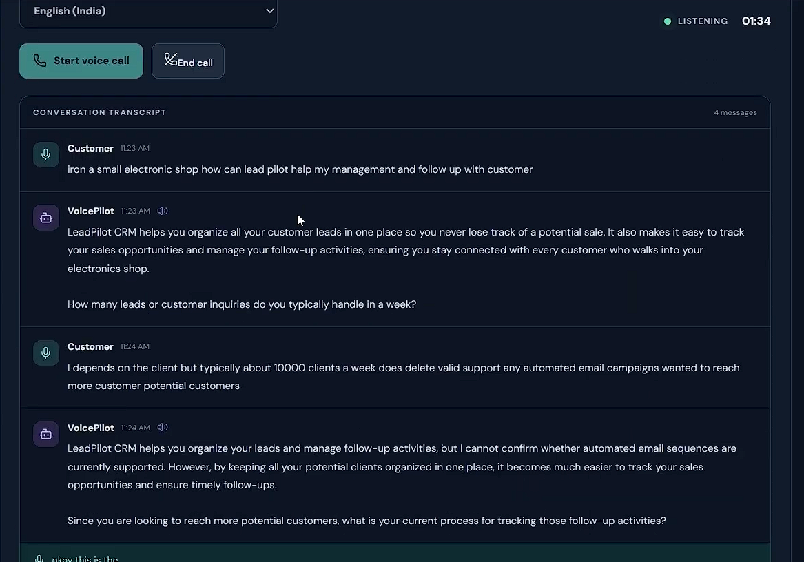
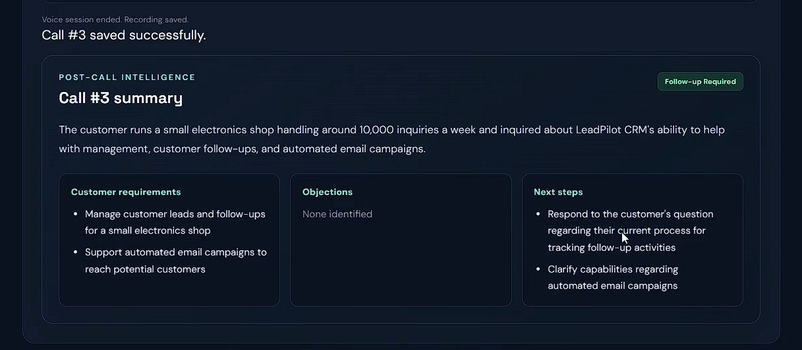
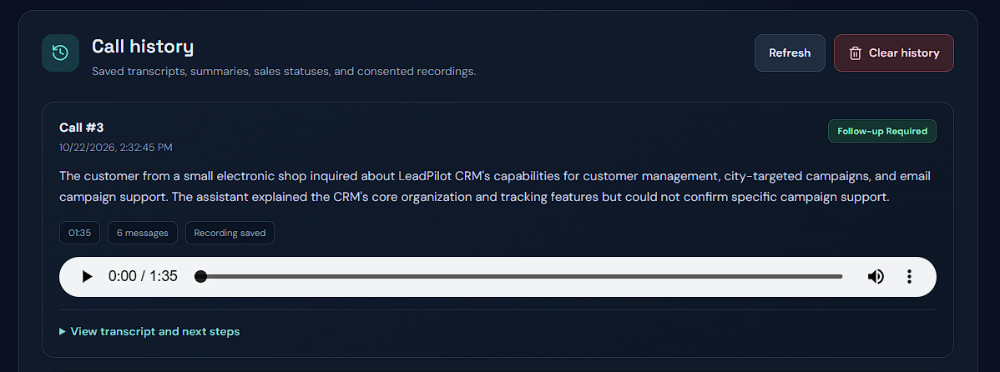
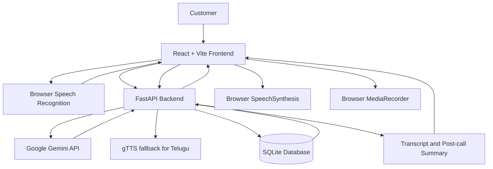

<h1>
   VoicePilot: AI Voice Sales Bot
</h1>

**A browser-based AI voice sales assistant for conversational product discovery and post-call intelligence.**

<!-- Frontend, Backend & LLM-->
<p align="center">
  
  
  
  
  
</p>

<!-- Voice, Data & Testing -->
<p align="center">
  
  
  
  
  
</p>

<!-- Deployment -->
<p align="center">
  
  
</p>

---

## Live Demo:

- **Watch the demo:** [https://youtu.be/tAPfSio8lV8](https://youtu.be/tAPfSio8lV8) ~ 3 min
- **Live Application:** [https://voicepilot-ai-pearl.vercel.app/](https://voicepilot-ai-pearl.vercel.app/)
- **Backend API:** [https://voicepilot-backend-iebl.onrender.com/](https://voicepilot-backend-iebl.onrender.com/)
- **Swagger Documentation:** [https://voicepilot-backend-iebl.onrender.com/docs](https://voicepilot-backend-iebl.onrender.com/docs)

---

## Overview

VoicePilot is a browser-based AI voice sales bot developed for a 48-hour internship assignment for **Sankar Group**. It simulates a sales conversation with a potential customer about **LeadPilot CRM**, a fictional SaaS product.

The application combines browser speech capabilities, a Gemini-powered response service, call recording with explicit consent, and post-call analysis. After a conversation ends, it can save the transcript and call details, generate a structured summary, and classify the sales outcome.

> **Demo-product note:** LeadPilot CRM is fictional and is used only to demonstrate the conversation flow. The assistant is intentionally restricted to confirmed product capabilities: organizing leads, tracking sales opportunities, and managing follow-up activities. It should not invent pricing, integrations, or unverified features.


## Application Screenshots

### 1. Live Voice Conversation

The live conversation interface allows customers to interact with VoicePilot through voice. It displays the conversation transcript, AI-generated responses, language selection, call controls, and call duration. Recording is enabled only with explicit user consent.



### 2. AI-Generated Post-Call Summary

After a call ends, VoicePilot generates a structured summary containing the customer's requirements, identified objections, suggested next steps, and the sales outcome. This helps make the conversation easier to review and follow up on.



### 3. Call History and Recording Playback

The call history interface displays saved conversations, timestamps, summaries, sales statuses, and recording availability. Users can review call details and play back recordings when available.




## Key Features

### 1. Voice conversation

-   Browser-based speech recognition for customer input.
-   Live conversation transcript, including interim speech text where supported.
-   Language selection and start/end call controls.
-   Gemini-generated responses routed through the backend, keeping the API key out of frontend code.
-   Browser speech synthesis for English and Hindi.
-   Best-effort backend `gTTS` fallback for Telugu responses when a suitable browser voice is unavailable.

### 2. Consent-based recording

-   Recording is **off by default**.
-   The user must explicitly select the recording-consent checkbox before a call is recorded.
-   Calls can proceed without recording consent.
-   Saved recordings can be played back from call history when the recording and database remain available.

### 3. Post-call intelligence

-   Call duration and transcript storage.
-   Generated post-call summary.
-   Structured customer requirements, objections, and next steps.
-   One validated sales outcome per completed call.

Supported sales outcomes: - `Converted` - `Interested` - `Follow-up Required` - `Not Interested` - `Demo Requested` - `No Response`

### 4. Call history

-   View saved call details, transcript, summary, recording availability, and sales status.
-   Clear saved history through an explicit confirmation step.
-   Clearing history permanently removes saved call records and their embedded recordings from the SQLite database.

## Architecture

The application is split into a React frontend and a FastAPI backend. The frontend handles the browser UI and speech/recording APIs; the
backend communicates with Gemini, provides text-to-speech support, and stores completed call data in SQLite.



### Main components

| Component | Responsibility |
| :--- | :--- |
| **React + Vite frontend** | Conversation UI, language selection, transcript display, call controls, consent UI, recording playback, and history |
| **Browser Web Speech API** | Speech recognition where supported by the browser |
| **Browser SpeechSynthesis** | English/Hindi speech output where suitable voices are available |
| **FastAPI backend** | API endpoints, Gemini requests, text-to-speech fallback, validation, and persistence |
| **Google Gemini API** | Generates conversational responses and post-call analysis |
| **gTTS** | Best-effort Telugu speech output through the backend |
| **SQLite** | Stores completed call details and consented audio recordings |


## Technology Stack

| Category | Technology / Tool | Specific Role / Notes |
| :--- | :--- | :--- |
| **Frontend** | React, Vite, CSS | Main client framework, bundler, and styling. |
| | Browser Web Speech APIs | Native client-side speech processing capabilities. |
| **Backend** | Python, FastAPI, Uvicorn | Server language, core API framework, and ASGI server. |
| | Pydantic, Python `sqlite3` | Data validation/settings management and lightweight database driver. |
| **AI & Speech** | Google Gen AI Python SDK | Official package to interface with the Gemini API. |
| | Gemini (`gemini-3.5-flash-lite`) | Active LLM for conversation generation and post-call analysis. |
| | Browser `SpeechRecognition` & `SpeechSynthesis` | Direct client-side audio input and English/Hindi voice output. |
| | `gTTS` | Backend fallback library for Telugu text-to-speech generation. |
| **Testing & CI/CD** | Pytest | Test suite runner for the backend codebase. |
| | GitHub Actions | Automated workflows for backend testing and frontend build verification. |


## Run Locally

### Prerequisites

-   Python version compatible with the backend dependencies.
-   Node.js and npm.
-   A Google Gemini API key for AI responses.
-   A modern desktop browser. Chrome or Edge is recommended for speech-recognition support.

### 1. Clone the repository

``` bash
git clone https://github.com/Abhishek-369V/ai-voice-sales-bot.git
cd ai-voice-sales-bot
```

### 2. Configure and run the backend

From the repository root:

``` powershell
cd backend
python -m pip install -r requirements-dev.txt
Copy-Item .env.example .env
```

Add your Gemini API key to `backend/.env`:

``` dotenv
GEMINI_API_KEY=your_gemini_api_key
```

Do not commit `.env` or expose the API key in frontend variables,
screenshots, logs, or public documentation.

Start the backend:

``` powershell
uvicorn app.main:app --reload --port 8000
```

The API documentation should be available at:

`http://127.0.0.1:8000/docs`

### 3. Configure and run the frontend

Open a separate terminal at the repository root:

``` powershell
cd frontend
npm ci
npm run dev
```

Open the local URL printed by Vite (typically `http://localhost:5173`).

If required, configure `VITE_API_BASE_URL` to point to the backend base
URL. This is public frontend configuration; **never put the Gemini API
key in a `VITE_` variable**.

## Validation

Run backend tests:

``` powershell
cd backend
python -m pytest -q
```

Build the frontend:

``` powershell
cd frontend
npm ci
npm run build
```

GitHub Actions is configured to run backend tests and check the frontend
production build.

## Deployment

The current hosted setup is:

| Layer | Platform | URL |
| :--- | :--- | :--- |
| **Frontend** | Vercel | [https://voicepilot-ai-pearl.vercel.app/](https://voicepilot-ai-pearl.vercel.app/) |
| **Backend** | Render | [https://voicepilot-backend-iebl.onrender.com/](https://voicepilot-backend-iebl.onrender.com/) |
| **API docs** | FastAPI / Swagger UI | [https://voicepilot-backend-iebl.onrender.com/docs](https://voicepilot-backend-iebl.onrender.com/docs) |

The frontend uses `VITE_API_BASE_URL` to reach the backend. The backend uses server-side environment variables for the Gemini API key, model selection, and allowed frontend origin.

Typical backend environment variables:

| Variable | Purpose |
| :--- | :--- |
| `GEMINI_API_KEY` | Secret key used by the backend to call Gemini |
| `GEMINI_MODEL` | Gemini model identifier |
| `FRONTEND_ORIGIN` | Allowed frontend origin for CORS |
| `VOICEPILOT_DB_PATH` | Optional database path if configured by the application |

> ⚠️ **Security Reminder:** Never publish secret values. Configure them securely in the hosting provider's environment-variable settings.

## Browser, Recording, and Data Notes

-   Use desktop Chrome or Edge for the best chance of browser speech-recognition support.
-   Microphone permission may be required by the browser.
-   Speech recognition quality and supported languages vary by browser, operating system, and device.
-   Recording is off by default and requires explicit consent.
-   Audio playback depends on the recording and its database record still being available.
-   Do not commit `.env` files, recordings, or the SQLite database.
-   Clearing call history permanently deletes the stored call records and embedded recordings.

## Known Limitations and Trade-offs

-   **Browser speech recognition:** availability and language quality depend on browser support and device configuration.
-   **Telugu text-to-speech:** the `gTTS` fallback uses an unofficial Google Translate speech endpoint, requires internet access, and may be rate-limited or change without notice. It is a best-effort demo fallback, not a production SLA-backed speech service.
-   **Live conversation context:** the frontend currently sends each latest customer message to Gemini separately. Post-call analysis uses the complete saved transcript, but the live assistant is not yet provided with the full conversation history as model context.
-   **SQLite hosting:** SQLite is suitable for a demo or single-instance deployment. On ephemeral hosting, saved data may be lost after a restart or redeploy. Multi-instance or production hosting should use durable shared storage.
-   **Fictional product information:** pricing, integrations, automated email campaigns, reminders, and analytics are unconfirmed. The assistant should state that it cannot confirm a capability rather than inventing product details.

## Product Guardrails

LeadPilot CRM is a fictional demonstration product. The assistant may describe only these confirmed capabilities:

1.  Organize leads.
2.  Track sales opportunities.
3.  Manage follow-up activities.

Unconfirmed features are not necessarily unavailable. The assistant should clearly say when it cannot verify a capability and avoid fabricating product facts.

## Project Decisions

For significant architecture decisions and trade-offs, see [`decision_log.md`](./decision_log.md).

## Security and Privacy

-   Keep the Gemini API key on the backend.
-   Do not commit `.env`, local databases, or recorded customer audio.
-   Obtain explicit recording consent before capturing a call.
-   Clear-history behavior permanently removes stored calls and their embedded recordings.
-   Before using the application with real customers, add a documented retention policy, durable storage, appropriate access controls, and a privacy review.

## Assignment Context

This project was built as a 48-hour internship assignment for Sankar Group. It demonstrates a practical integration of a React interface, a Python API, an LLM, browser speech capabilities, consent-based recording, and post-call analysis.

---

## Author

**Madanala Abhishek Varma**  

Computer Science & Engineering Graduate · AI / ML / Data Science

**LinkedIn:** [linkedin.com/in/madanala-abhishek-varma/](https://www.linkedin.com/in/madanala-abhishek-varma/)  

---